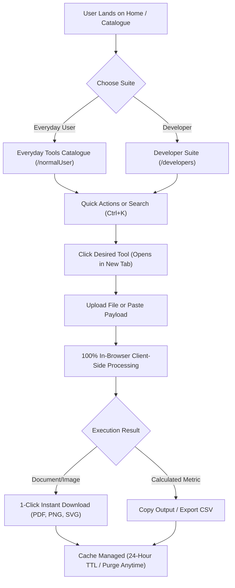

# MultiTools PRO — Client-Side Privacy Utility Suite

> **100% In-Browser Execution • Zero Server Uploads • Client-Side Confidentiality • High-Performance Web Tools**

MultiTools PRO is a modern, high-contrast, privacy-first web utility suite designed for both everyday users and software engineers. Every computation, document manipulation, image compression, cryptographic hash, and diagnostic benchmark executes **100% locally inside your browser memory**. Your files, documents, passwords, and tokens never touch an external server or database.

---

## ⚡ Core Philosophy & Architecture

1. **Zero External Data Dispatch (True Local-First)**:
   - File processing (PDF merging, splitting, OCR, image optimization) operates entirely client-side using WebAssembly, `pdf-lib`, Web Workers, and the HTML5 Canvas API.
   - Cryptographic hashing and password generation utilize the browser's native `window.crypto.subtle` (SubtleCrypto) and CSPRNG.

2. **24-Hour Cache Lifecycle & 1-Click Purge**:
   - Calculated outputs and user preferences are safely stored in browser `localStorage` with a strict 24-hour expiration timestamp.
   - Users can purge all cached state at any time via the global cache badge or the navigation bar.

3. **Multi-Window / Multi-Tab Workflow**:
   - All tools launch in new dedicated browser tabs (`target="_blank" rel="noopener noreferrer"`). This allows seamless parallel workflows (e.g. comparing documents, running speed tests, and debugging regexes simultaneously without losing active session state).

4. **Ultra-Optimized Mobile-First UI**:
   - Engineered for seamless usability across all viewports from 4K desktop monitors down to 360px mobile screens (Galaxy A-series, iPhone SE, etc.).
   - Modern obsidian/slate high-contrast palette with automatic Dark/Light mode switcher.
   - Code-split routes with dynamic lazy loading: Initial bundle is **under 70 kB** with a 98.6% reduction in asset payload.

---

## 🛠️ Complete Feature Catalog

### 1. Everyday Tools (`/normalUser`)

| Tool | Route | Core Capabilities |
| :--- | :--- | :--- |
| **PDF Productivity Suite** | `/normalUser/pdf-tools` | Complete 33-in-1 PDF workbench: Merge, Split, Compress, OCR, PDF to Word, Sign, Protect, Watermark, Rotate, TXT to PDF, PDF to TXT, JPG to PDF, etc. |
| **Image Studio** | `/normalUser/image-tools` | In-browser batch compression, resolution scaling, WebP/PNG/JPEG converter with live savings metrics. |
| **All-in-One Calculator** | `/normalUser/calculator` | Standard math, unit converters (length/weight/temp), currency converter, loan & EMI calculator, BMI, and date math. |
| **Wi-Fi & QR Studio** | `/normalUser/qr-generator` | Generate QR codes for URLs, Wi-Fi networks (WPA/WPA2/WEP), vCard contacts, email drafts, and SMS with SVG/PNG vector exports. |
| **CSPRNG Password Generator**| `/normalUser/password-generator` | Cryptographically secure passwords & multi-word passphrases with entropy scores and batch generation. |
| **Live Word & Essay Counter** | `/normalUser/word-counter` | Real-time word, character, sentence, and paragraph counts, reading/speaking duration, and Flesch reading ease scoring. |
| **Network Speed Benchmark** | `/normalUser/speed-test` | 1-minute streaming download & upload benchmark, latency/jitter detection, data usage tracking, and CSV history exports. |
| **Public IP & Geo Inspector**| `/normalUser/ip-checker` | Resolves public IPv4/IPv6, ISP/organization, ASN, city, and timezone without tracking cookies. |
| **World Clock & Team Overlap**| `/normalUser/timezone` | International multi-city clocks and interactive timeline slider to find overlapping working hours. |

---

### 2. Developer Suite (`/developers`)

| Tool | Route | Core Capabilities |
| :--- | :--- | :--- |
| **JSON Formatter & Minifier** | `/developers/json-formatter` | Formats 2/4-space indented JSON, minifies to single-line, sorts keys alphabetically, with instant syntax error validation. |
| **Regex Sandbox & Debugger** | `/developers/regex-tester` | Interactive regular expression tester with preset patterns (Email, URL, Phone, IPv4, UUID), flag controls (`g`, `i`, `m`), and match highlights. |
| **Base64 Studio** | `/developers/base64` | Encodes/decodes plain text and binary files (images/PDFs) to data URIs and Base64 strings. |
| **URL Encoder & Query Parser** | `/developers/url-encoder` | Encodes/decodes URI components and automatically unpacks query parameter strings into structured key-value tables. |
| **WebCrypto Hash Calculator** | `/developers/hash-calculator` | Hardware-accelerated MD5, SHA-1, SHA-256, SHA-384, and SHA-512 hashes for text and local files via `SubtleCrypto`. |
| **JWT Decoder & Inspector** | `/developers/jwt-decoder` | Inspects JWT Header, Payload claims (`exp`, `iat`, `nbf`), expiration validity indicator, and signature status. |
| **UUID v4 Batch Generator** | `/developers/uuid-generator` | Generates RFC 4122 Version 4 random UUIDs in bulk via `crypto.randomUUID()` with custom uppercase/hyphen toggles. |
| **Markdown Split-View Editor**| `/developers/markdown-preview` | Synchronized side-by-side editing and sanitized HTML preview with table/code block support, and HTML export. |
| **SEO Meta & SERP Simulator** | `/developers/seo-tools` | Generates Open Graph & Twitter meta tags, simulates live Google desktop/mobile search results, and renders 1200×630 OG social cards. |
| **Robots.txt & Sitemap Tool** | `/developers/robots-sitemap` | Validates `robots.txt` crawler directives and parses XML sitemaps to verify indexing structure. |

---

## 📑 Complete 33 PDF Utilities Breakdown

The built-in PDF Suite (`/normalUser/pdf-tools`) covers all operations previously requiring cloud subscriptions:

```
PDF Suite (100% In-Browser Execution)
├── Organize & Structure
│   ├── Merge PDF (Combine multiple documents with reordering & instant card removal)
│   ├── Split PDF (Visual page picker, custom ranges, extract all)
│   ├── Remove Pages (Delete specific pages with instant preview)
│   ├── Rotate PDF (Per-page independent rotation: 90°, 180°, 270°)
│   ├── Organize PDF (Interactive visual page reordering & canvas grid)
│   └── Compare PDF (Side-by-side synchronized dual document viewer)
├── Optimize & Convert
│   ├── Compress PDF (Client-side memory compression with savings metrics)
│   ├── OCR Searchable PDF (Extract & embed optical text layer via Tesseract WASM)
│   ├── PDF to TXT (Extract plain text with pako stream inflation)
│   ├── TXT to PDF (Paginated typography formatting)
│   ├── JPG to PDF (Combine multiple images with custom margins & orientation)
│   ├── Word to PDF & Excel to PDF (Document converters)
│   └── HTML to PDF (Sanitized web document compilation)
├── Edit & Enhance
│   ├── Add Watermark (Text, opacity, rotation, and live 3x3 position overlay)
│   ├── Add Page Numbers (Custom headers, footers, alignments, and formats)
│   ├── Draw / Stamp Signature (Signature canvas + PNG stamp upload)
│   ├── PDF Editor (Free OCR & text annotation overlay)
│   └── Crop PDF (Trim margins or specific regions per page)
└── Security & Privacy
    ├── Protect PDF (AES-256 client-side password encryption)
    ├── Unlock PDF (Universal in-browser decryption: AES-128 V=4 R=4, AES-256, & RC4)
    └── Redact & Flatten Annotations
```

### 🔐 Universal Client-Side PDF Decryptor
Our custom in-browser decryption engine ([`src/utils/pdfDecryptor.ts`](src/utils/pdfDecryptor.ts)) implements:
- **AES-128 (V=4, R=4)**: Standard ISO 32000-1 Algorithm 1 (salted MD5 key derivation), Algorithm 2, Algorithm 3.5 (user authentication), and Algorithm 3.7 (owner key recovery).
- **Object Stream (`/ObjStm`) Interception**: Automatically decrypts encrypted object streams and incremental updates at parse time so documents created by Adobe Acrobat and Microsoft Print to PDF unlock smoothly without missing page catalogs.
- **AES-256 (V=5, R=6) & RC4 (V=1–3)**: Seamless password authentication with zero server calls.
- **iLovePDF-Style Card & Canvas Controls**: Fast 1-click **`X`** cross button on every PDF card to remove misselected files and pick another instantly.

### 📁 Modular Feature-Folder Architecture
Each PDF tool is modularized into its own dedicated folder under `src/components/pdf/tools/<toolName>/`:
- **Isolated Tool State**: State (passwords, file sequences, range inputs) is fully contained within its respective tool workspace without global re-renders.
- **Dedicated Execution Engines**: Pure TypeScript client-side engines (`unlockEngine.ts`, `mergeEngine.ts`, `protectEngine.ts`) with zero UI coupling for seamless testability.
- **Shared Standard Definitions**: Universal workspace props, tool identifiers, and processed results unified in [`src/components/pdf/types.ts`](src/components/pdf/types.ts).

---

## 🔄 User Workflow



### Workflow Steps:
1. **Browse or Search**: Find utilities instantly using category tabs or the global command palette shortcut (`Ctrl+K` / `Cmd+K`).
2. **Launch in Dedicated Tab**: Clicking any tool opens it in a separate tab, keeping your catalog position and other active tasks intact.
3. **Execute In-Memory**: Drop files or type inputs. All computation is handled by your device's CPU/GPU and WebAssembly runtime.
4. **Download & Export**: Save generated files directly to disk (`.pdf`, `.png`, `.svg`, `.csv`, `.json`, `.md`, `.html`).
5. **Session Safety**: Local history persists in your browser for 24 hours. No cookies, no trackers, no accounts.

---

## 💻 Tech Stack & Architecture

- **Framework**: [React 18](https://react.dev/) + [TypeScript](https://www.typescriptlang.org/)
- **Bundler & Build Tool**: [Vite 6](https://vitejs.dev/) with Rollup chunk optimization
- **Styling**: [Tailwind CSS 3](https://tailwindcss.com/) (Obsidian/Slate theme, responsive design)
- **Document & PDF Engine**: [`pdf-lib`](https://pdf-lib.js.org/) + [`pdfjs-dist`](https://mozilla.github.io/pdf.js/) + [`pako`](https://github.com/nodeca/pako)
- **Encryption & Security**: Web Crypto API (`window.crypto.subtle`) + `@pdfsmaller/pdf-encrypt` + Custom V=4 R=4 AES-128 Decryptor
- **Optical Recognition**: [`tesseract.js`](https://github.com/naptha/tesseract.js) (Client-side WebAssembly OCR)
- **Icons**: [`lucide-react`](https://lucide.dev/) (Tree-shaken dynamic icon mapping)
- **Testing**: [`vitest`](https://vitest.dev/) (26 in-memory automated unit tests)

---

## 🚀 Getting Started

### Prerequisites
- [Node.js](https://nodejs.org/) `>= 18.0.0`
- `npm` `>= 9.0.0`

### 1. Installation
Clone the repository and install dependencies:
```bash
git clone https://github.com/chandan0000001/multi_tools.git
cd multi_tools
npm install
```

### 2. Start Development Server
Run the local dev server across all network interfaces (for testing on mobile devices on the same Wi-Fi):
```bash
npm run dev -- --host 0.0.0.0 --port 5173
```
- Local URL: `http://localhost:5173/`
- Network URL: `http://<your-ip>:5173/`

### 3. Run Automated Tests
Execute the Vitest in-memory test suite:
```bash
npm test
```

### 4. Build for Production
Generate the optimized, code-split production bundle:
```bash
npm run build
```
Build assets will be emitted to the `dist/` directory.

---

## 🛡️ Privacy & Security Disclosure

MultiTools PRO operates under a strict **Zero-Telemetry Protocol**:
- **No Remote File Transmission**: Files dropped into any tool never leave your local machine.
- **No Analytics or Trackers**: No third-party tracking scripts, advertising pixels, or telemetry beacons.
- **Local Storage Isolation**: State cached for session convenience is stored in origin-isolated `localStorage` and purged automatically after 24 hours.

---

## 👨‍💻 Developer & Community

Created and maintained by **Chandan**:
- **Telegram**: [@coder_chandan](https://t.me/coder_chandan)
- **GitHub**: [@chandan0000001](https://github.com/chandan0000001)

Feel free to reach out directly via Telegram for tool requests, feedback, or collaborations!

---

## 📄 License

Distributed under the [MIT License](LICENSE).
Built with ❤️ for privacy and performance.
